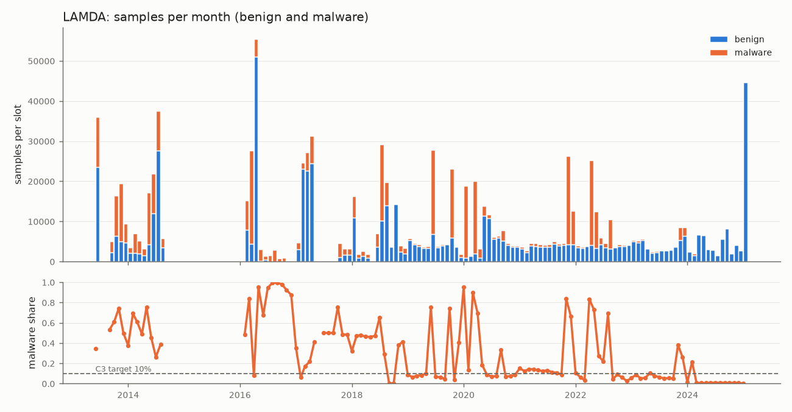
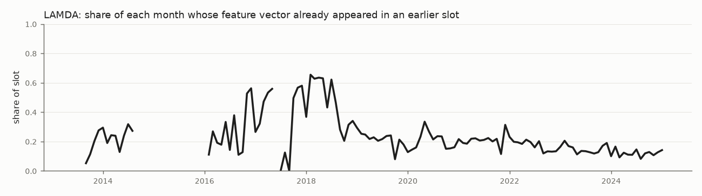
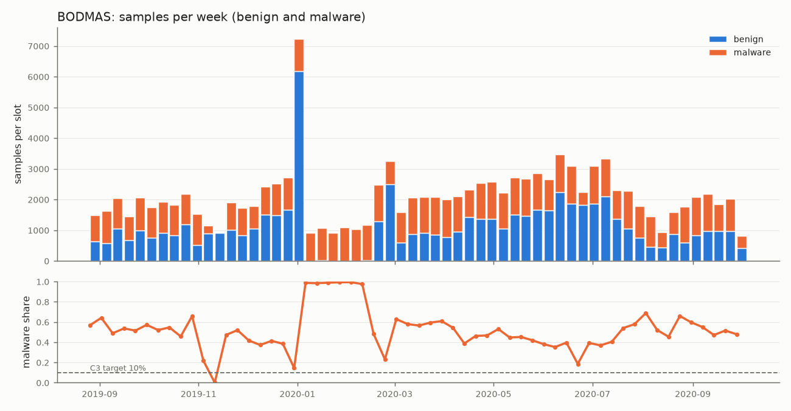

# Data inventory (Phase 2)

Generated by `uv run driftwatch data inventory` from `data/manifest.json` (content hash `sha256:723136f91b38a46e582e3918d759964341ca819a72f6597568d7557eca122a63`) and the per-unit caches. Do not edit by hand: regenerate. Interpretation, decisions and open questions are in [data_inventory_notes.md](data_inventory_notes.md) and ADR-0004.

## LAMDA

Table view: [units](tables/data_lamda_units.csv); slots: [month](tables/data_lamda_slots_month.csv), [quarter](tables/data_lamda_slots_quarter.csv).

### Overview
| item | value |
|---|---|
| source | IQSeC-Lab/LAMDA |
| version | ad9614bdd5556767f97ced2fce797c2f06408ebf |
| rows | 1008381 |
| malware | 369906 |
| benign | 638475 |
| malware share | 0.3668 |
| features | 4561 |
| feature dtype | int8 |
| density (non-zero share) | 0.01633 |
| base unit | month |
| populated base units | 120 |
| timestamp used | added (AndroZoo) when inside year_month, else first of the month |
| raw size on disk | 340.5 MB |
| cache size on disk | 119.6 MB |
| build peak memory | 0.85 GB (cap 1.50 GB) |
| build wall-clock | 93.1 s |
| build code version | a373692 |

### Timestamps
| item | value |
|---|---|
| min | 2013-06-09T21:44:12+00:00 |
| max | 2025-01-26T23:59:10+00:00 |
| share_with_time_of_day | 1.0 |
| distinct_days | 3113 |
| malware_min | 2013-06-09T21:44:39+00:00 |
| malware_max | 2025-01-25T14:59:05+00:00 |
| malware_p01 | 2013-06-10T03:21:17.300000+00:00 |
| malware_share_at_midnight | 0.0 |
| malware_most_common_ts | 2018-01-19T09:33:26+00:00 x 13 |
| benign_min | 2013-06-09T21:44:12+00:00 |
| benign_max | 2025-01-26T23:59:10+00:00 |
| benign_p01 | 2013-06-10T02:41:34.920000+00:00 |
| benign_share_at_midnight | 0.0 |
| benign_most_common_ts | 2013-06-10T19:10:50+00:00 x 7 |
| share_ts_equals_added | 1.0 |
| rows_without_added | 0 |

Rows per year and class ([csv](tables/data_lamda_years.csv)):

| year | benign | malware |
|---|---|---|
| 2013 | 42048 | 44383 |
| 2014 | 55427 | 45756 |
| 2016 | 64059 | 45134 |
| 2017 | 77785 | 21359 |
| 2018 | 64942 | 39350 |
| 2019 | 49465 | 41585 |
| 2020 | 55718 | 46355 |
| 2021 | 45528 | 35627 |
| 2022 | 44768 | 41648 |
| 2023 | 46462 | 7892 |
| 2024 | 47633 | 794 |
| 2025 | 44640 | 23 |

### Identifiers
| item | value |
|---|---|
| ids_not_sha256 | 0 |
| their_prefixes | {} |
| their_labels | {} |

### Slot occupancy and minimum-size gate
A slot passes gate M when it holds at least M malware and 9M benign, so that C3 subsampling to 10% malware keeps M malware. Gap slots hold no rows; "longest passing run" counts consecutive passing slots (gaps break a run).

| slot_length | slots_in_span | gap_slots | non_empty_slots | M | passing_slots | longest_passing_run | run_start | run_end |
|---|---|---|---|---|---|---|---|---|
| month | 140 | 20 | 120 | 30 | 101 | 66 | 2018-11-01 | 2024-05-01 |
| month | 140 | 20 | 120 | 50 | 97 | 62 | 2018-11-01 | 2024-01-01 |
| month | 140 | 20 | 120 | 100 | 93 | 62 | 2018-11-01 | 2024-01-01 |
| quarter | 48 | 5 | 43 | 30 | 39 | 29 | 2017-10-01 | 2025-01-01 |
| quarter | 48 | 5 | 43 | 50 | 39 | 29 | 2017-10-01 | 2025-01-01 |
| quarter | 48 | 5 | 43 | 100 | 37 | 26 | 2017-10-01 | 2024-04-01 |

### Duplicates

| item | value |
|---|---|
| dataset | lamda |
| rows | 1008381 |
| distinct_vectors | 679423 |
| rows_sharing_a_vector | 421860 |
| vectors_with_both_labels | 2177 |
| rows_in_label_conflicting_vectors | 54835 |
| sha256_duplicate_rows | 0 |
| sha256_in_several_units | 0 |
| vectors_in_several_slots_month | 63908 |
| rows_seen_in_earlier_slot_month | 238576 |
| vectors_in_several_slots_quarter | 52425 |
| rows_seen_in_earlier_slot_quarter | 196556 |

Per-slot table: [duplicates per slot](tables/data_lamda_duplicates_per_slot.csv).

### Families (malware)
| item | value |
|---|---|
| named_families | 1381 |
| named_families_with_10_or_more | 435 |
| malware_singleton_labels | 150604 |
| malware_without_family | 0 |
| malware_in_top_10_families | 130427 |

Top 20: [families](tables/data_lamda_families_top20.csv).

### Missing values and consistency checks (from the build)
| item | value |
|---|---|
| added_month_mismatch | 0 |
| added_null | 0 |
| family_null_benign | 0 |
| family_null_malware | 0 |
| feature_nulls | 0 |
| folder_year_mismatch | 0 |
| max_value | 17 |
| meta_family_conflicts | 0 |
| meta_label_conflicts | 0 |
| meta_missing | 0 |
| meta_vt_conflicts | 0 |
| nnz | 75089877 |
| rows_read | 1008381 |
| vt_label_conflicts | 0 |
| vt_non_integral | 0 |
| vt_null | 0 |
| excluded | {} |
| metadata_csv_duplicate_sha256 | 0 |

## BODMAS

Table view: [units](tables/data_bodmas_units.csv); slots: [1w](tables/data_bodmas_slots_1w.csv), [2w](tables/data_bodmas_slots_2w.csv), [4w](tables/data_bodmas_slots_4w.csv).

### Overview
| item | value |
|---|---|
| source | https://drive.google.com/drive/folders/1Uf-LebLWyi9eCv97iBal7kL1NgiGEsv_ |
| version | {'bodmas.npz': '1_7uhKCrc9hmIOxxfZMoKK6aP8-GJ-DNJ', 'bodmas_malware_category.csv': '10bdoOn9qhf647HwANpAga78ye8rOEgwJ', 'bodmas_metadata.csv': '16UtiitjekNfqHGlLWtxkxyuU23o2qaja'} |
| rows | 134435 |
| malware | 57293 |
| benign | 77142 |
| malware share | 0.4262 |
| features | 2381 |
| feature dtype | float32 |
| density (non-zero share) | 0.27594 |
| base unit | week |
| populated base units | 424 |
| timestamp used | metadata `timestamp` (first appearance, per the BODMAS page), UTC |
| raw size on disk | 265.5 MB |
| cache size on disk | 1230.5 MB |
| build peak memory | 0.55 GB (cap 1.50 GB) |
| build wall-clock | 23.1 s |
| build code version | 7a6032a |

### Timestamps
| item | value |
|---|---|
| min | 2007-01-01T08:46:39+00:00 |
| max | 2020-09-30T03:05:27+00:00 |
| share_with_time_of_day | 0.5078 |
| distinct_days | 1181 |
| malware_min | 2019-08-29T09:59:25+00:00 |
| malware_max | 2020-09-30T03:05:27+00:00 |
| malware_p01 | 2019-08-31T22:13:23.080000+00:00 |
| malware_share_at_midnight | 0.0 |
| malware_most_common_ts | 2020-07-11T23:02:11+00:00 x 19 |
| benign_min | 2007-01-01T08:46:39+00:00 |
| benign_max | 2020-09-30T00:00:00+00:00 |
| benign_p01 | 2015-01-01T00:00:00+00:00 |
| benign_share_at_midnight | 0.8577 |
| benign_most_common_ts | 2020-01-01T00:00:00+00:00 x 5877 |

Rows per year and class ([csv](tables/data_bodmas_years.csv)):

| year | benign | malware |
|---|---|---|
| 2007 | 6 | 0 |
| 2008 | 13 | 0 |
| 2009 | 37 | 0 |
| 2010 | 36 | 0 |
| 2011 | 90 | 0 |
| 2012 | 53 | 0 |
| 2013 | 54 | 0 |
| 2014 | 78 | 0 |
| 2015 | 1653 | 0 |
| 2016 | 288 | 0 |
| 2017 | 2462 | 0 |
| 2018 | 5872 | 0 |
| 2019 | 20686 | 15823 |
| 2020 | 45814 | 41470 |

### Identifiers
| item | value |
|---|---|
| ids_not_sha256 | 7 |
| their_prefixes | {'virusshare': 7} |
| their_labels | {0: 7} |

### Slot occupancy and minimum-size gate
A slot passes gate M when it holds at least M malware and 9M benign, so that C3 subsampling to 10% malware keeps M malware. Gap slots hold no rows; "longest passing run" counts consecutive passing slots (gaps break a run).

| slot_length | slots_in_span | gap_slots | non_empty_slots | M | passing_slots | longest_passing_run | run_start | run_end |
|---|---|---|---|---|---|---|---|---|
| 1w | 718 | 294 | 424 | 30 | 51 | 33 | 2020-02-17 | 2020-10-05 |
| 1w | 718 | 294 | 424 | 50 | 49 | 25 | 2020-02-17 | 2020-08-10 |
| 1w | 718 | 294 | 424 | 100 | 33 | 16 | 2020-04-06 | 2020-07-27 |
| 2w | 359 | 84 | 275 | 30 | 27 | 17 | 2020-02-10 | 2020-10-05 |
| 2w | 359 | 84 | 275 | 50 | 27 | 17 | 2020-02-10 | 2020-10-05 |
| 2w | 359 | 84 | 275 | 100 | 27 | 17 | 2020-02-10 | 2020-10-05 |
| 4w | 180 | 22 | 158 | 30 | 14 | 9 | 2020-02-10 | 2020-10-19 |
| 4w | 180 | 22 | 158 | 50 | 14 | 9 | 2020-02-10 | 2020-10-19 |
| 4w | 180 | 22 | 158 | 100 | 14 | 9 | 2020-02-10 | 2020-10-19 |

### Duplicates
| item | value |
|---|---|
| dataset | bodmas |
| rows | 134435 |
| distinct_vectors | 134428 |
| rows_sharing_a_vector | 14 |
| vectors_with_both_labels | 0 |
| rows_in_label_conflicting_vectors | 0 |
| sha256_duplicate_rows | 0 |
| sha256_in_several_units | 0 |
| vectors_in_several_slots_1w | 4 |
| rows_seen_in_earlier_slot_1w | 4 |
| vectors_in_several_slots_2w | 4 |
| rows_seen_in_earlier_slot_2w | 4 |
| vectors_in_several_slots_4w | 4 |
| rows_seen_in_earlier_slot_4w | 4 |

Per-slot table: [duplicates per slot](tables/data_bodmas_duplicates_per_slot.csv).

### Families (malware)
| item | value |
|---|---|
| named_families | 582 |
| named_families_with_10_or_more | 196 |
| malware_singleton_labels | 0 |
| malware_without_family | 0 |
| malware_in_top_10_families | 29950 |

Top 20: [families](tables/data_bodmas_families_top20.csv).

### Missing values and consistency checks (from the build)
| item | value |
|---|---|
| bad_sha256 | 7 |
| inf | 0 |
| label_family_conflicts | 0 |
| malware_without_category | 0 |
| nan | 0 |
| nonzero | 88325432 |
| rows | 134435 |
| ts_unsorted | 0 |
| ts_with_time_of_day | 68266 |
| ts_without_offset | 3712 |
| ts_without_offset_malware_family | 0 |
| weeks_skipped | 0 |
